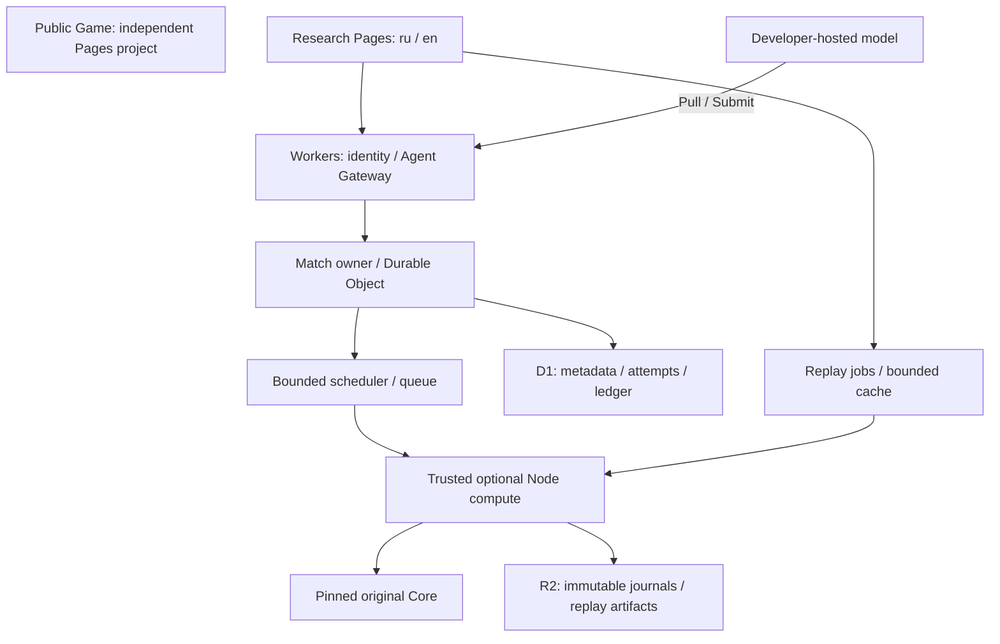

# ShashBesh AI Research Platform — L4-ARCH-01

Status: architecture proposal + local protocol prototype; no cloud resources.
Baseline: `7820e777bdd07e14595d34f231ecffb1d5c931f1`.
Documentation languages: RU / EN. Existing Lab is the compatibility baseline.

## RU — границы и решения

`shashbesh.pages.dev` — независимая публичная игра. Её репозиторий,
сборка, cookies, секреты, база и deployment не зависят от Research Lab.
`shashbesh-lab.pages.dev` — отдельный проект исследования. В этом этапе оба
адреса являются архитектурными целями: настройки сайтов не меняются.

Сохраняем существующие `LiveGameManager`, `ShashBeshEnvironment`, agents,
Storage, Viewer и ReplayService. Новый Agent Gateway — адаптер исследовательских
решений к Core, а не замена локального Live API. Встроенные агенты продолжают
работать; внешние агенты не импортируются в доверенный процесс.

Начальное решение: Workers управляет авторизацией, leases и очередями;
закреплённый Core исполняется существующим ограниченным Node worker на отдельном
доверенном compute. Compute не запускает код агентов. Нативное выполнение Core
в Workers — отдельный compatibility gate, не предположение.

Один владелец состояния на match_id: revision и принятие решения атомарны.
Внешняя модель получает задачу и возвращает предложение; только Core может
применить его, закончить бросок, назначить бонус или победителя. Core IDs 1–4,
Lab seats 0–3; хранить явную таблицу player_id/seat/core_player_id/agent_version.
2–4 независимых agent bindings, включая одинаковые стратегии, имеют отдельные
контексты и квоты. Не более одного человека в текущем Live UI; исследовательские
испытания могут быть полностью агентными. Порядок не вычисляется по modulo.

Схема хранения (будущая новая база): users, organizations, memberships,
api_tokens, agent_versions, rulesets, benchmark_versions, matches, participants,
decisions, attempts, leases, receipts, usage_reservations, ledger, replay_jobs.
Уникальности: (org, request_id), (decision, attempt_number), (task, lease_generation),
(match, revision), (ledger, settlement_key). Agent version неизменяема, содержит
model/provider/version, config hash, prompt hash, protocol и публичную декларацию.

Core eventLog хранится целиком и неизменно. Отдельный audit связывает каждую
попытку с decision_id, Core seq/state hash, revision, входом/выходом модели,
латентностью и отказом. Неверные попытки не добавляются как игровые действия.
Private seed/RNG counter и журналы не входят в Rules task. Публикация dataset
откладывается до завершения закрытого испытания.

Коммит Core-перехода и outbox атомарен у владельца; доставка D1/R2 повторяема.
При отсутствии подтверждения записи решение не публикуется. Восстановление
сверяет Core artifact hash, журнал и RNG, как существующий checkpoint. D1 —
индекс/отчётность; не второй конкурентный источник игрового состояния.

## EN — ownership and reuse

Public Game and Research Lab are independent projects and security boundaries.
Reuse the local controller, pinned adapter, built-in strategies, checkpoint and
Replay pipeline. The gateway translates agent decisions; it never implements
rules. A single match owner serializes revisions, leases and Core transitions.
Persist immutable Core events plus a separate, linked attempt audit. Invalid
proposals do not become moves. Use explicit Core-player / Lab-seat mapping.

Start with an edge control plane and bounded trusted Node compute. Do not run
third-party code beside Core. D1 holds tenant/experiment metadata; R2 stores
content-addressed journals; outbox and unique receipts make retries safe. No
existing research SQLite migration is planned. Production registration, billing,
network gateway and distributed ownership are designed here, not implemented.

## Related specifications

- [Agent protocol](AGENT_PROTOCOL_V1.md), [Rules benchmark](RULES_BENCHMARK.md)
- [Methodology](EXPERIMENTAL_METHODOLOGY.md), [Security](SECURITY_MODEL.md)
- [i18n](BILINGUAL_I18N.md), [Credits](BILLING_CREDITS.md)
- [Cloudflare compatibility](CLOUDFLARE_DEPLOYMENT.md), [Roadmap](IMPLEMENTATION_ROADMAP.md)
